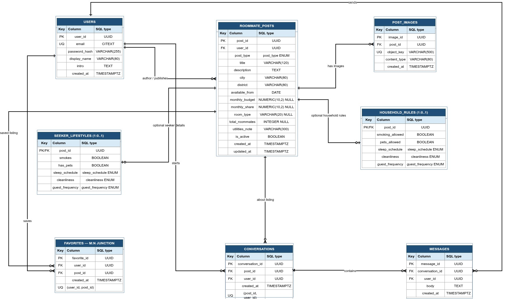
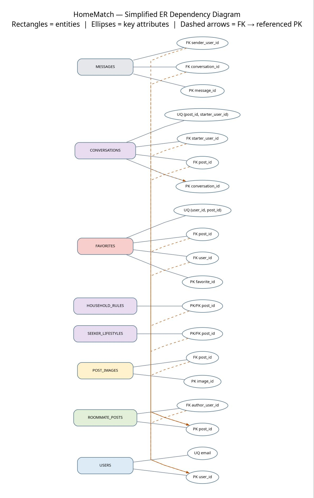

# HomeMatch — Lab 2 ER Diagram Design, Validation & Documentation

**Course:** Database Systems I — Fall 2026  
**Squad:** [Squad number/name]  
**Submission date:** [Date]

| Full name | Student ID | University email | Lab 2 role |
|---|---|---|---|
| [Member 1] | [ID] | [Email] | Business Owner (BO) |
| [Member 2] | [ID] | [Email] | Database Designer (DD) |
| [Member 3] | [ID] | [Email] | AI Developer (AID) |
| [Member 4] | [ID] | [Email] | Client & Endpoint Developer (CED) |

> Complete all bracketed cover fields and verify the squad’s Assignment 1 rules and member roles before PDF export. The report reflects the repository schema as inspected on 18 November 2026. It distinguishes implemented database constraints from application checks and proposed Assignment 3 controls.

<div style="page-break-before: always;"></div>

## Page 2 — Complete ER Diagram (Crow’s Foot)

The Page 2 diagram is embedded below from the uploaded [HomeMatch_ER_Diagram.jpg](HomeMatch_ER_Diagram.jpg). It uses entity tables with **Key**, **Column**, and **SQL type** columns and Crow’s Foot relationships. The editable [JSON](HomeMatch_ER_Diagram.json) and [draw.io](HomeMatch_ER_Diagram.drawio) sources are also included in the project.



**Figure 1.** HomeMatch entity relationship diagram. The normalized design separates seeker lifestyle and household rules into one-to-one subtype tables. ORM models and Alembic revision `0002_normalize` implement this target; the live database adopts it when the migration is applied. API payloads continue using their existing `id`/`author_id`/`sender_id` property names, so physical-column names do not change the JSON contract.

The JPG is embedded in this report as the Page 2 figure. For future edits, open `HomeMatch_ER_Diagram.drawio` in diagrams.net and export a replacement JPG using **File → Export as → JPEG**; keep the exported file named `HomeMatch_ER_Diagram.jpg` beside this Markdown report so the image link resolves.

All PKs are UUIDs with entity-specific column names. FK deletion behavior is `CASCADE`. `FAVORITES` has `UNIQUE(user_id, post_id)`; `CONVERSATIONS` has `UNIQUE(post_id, starter_user_id)`. Preference enums have DB CHECK constraints, and a deferred constraint trigger requires the subtype table matching `post_type`; image quota, positive price and bounds remain API-level rules.

# Role 1 — Business Owner (BO)

## 1. Business rule → ERD constraint mapping

The 14 rules below are copied from Assignment 1 (`rapor.md`); the mapping has one row for every rule.

| Rule | Short description | Representation in current ERD / enforcement |
|---|---|---|
| BR-01 | Listing has exactly one of two types | `roommate_posts.post_type VARCHAR(32) NOT NULL`; allowed values validated by API enum. DB CHECK is recommended, not yet present. |
| BR-02 | Each listing has an author; only author manages it | `roommate_posts.author_user_id NOT NULL FK → users.user_id`; ownership authorization is checked in API. |
| BR-03 | Seeker requires budget and lifestyle; no offer-only data | `monthly_budget` plus row in `seeker_lifestyles` keyed by `post_id`; API validation and deferred DB constraint trigger enforce the matching subtype. |
| BR-04 | Room offer requires share and household rules; no seeker-only data | `monthly_share` plus row in `household_rules` keyed by `post_id`; API validation and deferred DB constraint trigger enforce the matching subtype. |
| BR-05 | Public views expose active listings only; profile is private | `roommate_posts.is_active BOOLEAN NOT NULL`; filtering and endpoint separation in API. No DB row-level security currently. |
| BR-06 | Matches are complementary, active, and not self-authored | `post_type`, `is_active`, and `author_user_id`; matching service applies these predicates. |
| BR-07 | Offer share cannot exceed seeker budget | `monthly_budget` and `monthly_share`; matching query/service compares them. No DB constraint can enforce across two listing rows without additional logic. |
| BR-08 | Match score uses location/rent/lifestyle/date weights | Source fields are in `roommate_posts`; score and breakdown are computed by `services/matching.py`, deliberately not persisted. |
| BR-09 | One favorite per member/listing; remove is idempotent | `favorites.user_id FK`, `post_id FK`, `UNIQUE(user_id, post_id)`; idempotent delete in API. |
| BR-10 | One conversation per listing/starter; only participants access it | `conversations.post_id FK`, `starter_user_id FK`, `UNIQUE(post_id, starter_user_id)`; participant authorization in API. `messages` links sender and conversation. |
| BR-11 | Maximum five images, JPEG/PNG/WebP, each ≤10 MiB | `post_images.post_id FK`, `content_type`; file validation and count currently in API. Quota needs serialized transaction/trigger to be race-safe. |
| BR-12 | Unique email, hashed password, valid bearer token | `users.email NOT NULL UNIQUE`, `password_hash NOT NULL`; hash and token expiry handled in `security.py` and auth routes. |
| BR-13 | Listing/conversation deletion removes dependent data | FKs with `ON DELETE CASCADE` for listing, favorite, conversation, message, image dependencies; storage file deletion also handled in application code. |
| BR-14 | A public search returns at most 100 records | Listing columns and `is_active`; API caps result set at 100. This is a query limit, not a row constraint. |

## 2. Missing or conflicting rules report

| Rule | Why not fully enforced in the current ERD/database | Assignment 3 resolution |
|---|---|---|
| BR-11 | The five-image limit spans multiple rows, so a simple row CHECK cannot count images. Concurrent requests can both pass the API count check. | In one transaction, lock the parent listing row `FOR UPDATE`, count images, then insert only if count < 5; retain file cleanup on rollback. |
| BR-10 | Ordinary FKs do not guarantee that `messages.sender_user_id` equals either the listing author or conversation starter. | API participant check remains the enforcement point; a DB trigger can be added if non-API writers are introduced. |

These limitations are structural or authorization rules, not evidence that current API validation is absent.

## 3. User scenario walkthroughs

### Scenario A — Create a seeker listing, favorite an offer, and contact its author

1. Member registers: `INSERT INTO users (id, email, password_hash, display_name, intro, created_at) VALUES (...)`.
2. Member creates a seeker listing in one transaction: `INSERT INTO roommate_posts (..., author_user_id, post_type, monthly_budget, ...) VALUES (..., :user_id, 'looking_for_room', :budget, ...)`, then `INSERT INTO seeker_lifestyles (post_id, smokes, has_pets, sleep_schedule, cleanliness, guest_frequency) VALUES (...)`.
3. Visitor searches active offers: `SELECT ... FROM roommate_posts WHERE is_active = TRUE AND post_type = 'looking_for_roommate' ORDER BY created_at DESC LIMIT 100`.
4. Member saves an offer: `INSERT INTO favorites (favorite_id, user_id, post_id, created_at) VALUES (...)`; uniqueness protects against duplicate saves.
5. Member starts a conversation: `INSERT INTO conversations (conversation_id, post_id, starter_user_id, created_at) VALUES (...)`; application reuses an existing row if the unique pair already exists.
6. Member sends a message: `INSERT INTO messages (message_id, conversation_id, sender_user_id, body, created_at) VALUES (...)` after participant authorization.

Tables touched: `users`, `roommate_posts`, `seeker_lifestyles`, `favorites`, `conversations`, `messages` (6 tables).

### Scenario B — Provider publishes an offer with photos and answers an inquiry

1. Provider authenticates and reads own profile: `SELECT ... FROM users WHERE id = :user_id`.
2. Provider creates an offer in one transaction: `INSERT INTO roommate_posts (..., author_user_id, post_type, monthly_share, ...) VALUES (..., :user_id, 'looking_for_roommate', :share, ...)`, then `INSERT INTO household_rules (post_id, smoking_allowed, pets_allowed, sleep_schedule, cleanliness, guest_frequency) VALUES (...)`.
3. Provider uploads a photo: validate file, then `INSERT INTO post_images (image_id, post_id, object_key, content_type, created_at) VALUES (...)`; binary data is written to the persistent upload volume.
4. Seeker starts a conversation: `INSERT INTO conversations (...) VALUES (...)` for the offer and starter.
5. Provider lists conversations: `SELECT ... FROM conversations JOIN roommate_posts ... WHERE roommate_posts.author_user_id = :provider_id OR conversations.starter_user_id = :provider_id`.
6. Provider replies: `INSERT INTO messages (...) VALUES (...)` after checking participant role.

Tables touched: `users`, `roommate_posts`, `household_rules`, `post_images`, `conversations`, `messages` (6 tables), plus file storage.

# Role 2 — Database Designer (DD)

## 1. Entity technical reference

Abbreviations: PK = primary key, FK = foreign key. All columns marked NOT NULL in the implementation are shown as required. `TIMESTAMPTZ` corresponds to SQLAlchemy timezone-aware `DateTime`; nullable fields are explicitly identified.

| Entity | PK / FK(s) | Attributes and SQL types | Constraints | Purpose |
|---|---|---|---|---|
| `users` | PK `user_id UUID` | `email VARCHAR(320)`, `password_hash VARCHAR(255)`, `display_name VARCHAR(80)`, `intro TEXT`, `created_at TIMESTAMPTZ` | Required fields NOT NULL; `email UNIQUE` | Account, credentials hash, and member introduction. |
| `roommate_posts` | PK `post_id UUID`; FK `author_user_id UUID → users.user_id` | `post_type VARCHAR(32)`, `title VARCHAR(120)`, `description TEXT`, `city/district VARCHAR(80)`, `available_from DATE`, `monthly_budget/monthly_share NUMERIC(10,2) NULL`, `room_type VARCHAR(20) NULL`, `total_roommates INT NULL`, `utilities_note VARCHAR(300)`, `is_active BOOLEAN`, `created_at/updated_at TIMESTAMPTZ` | Required common fields NOT NULL; author FK cascades; type-specific subtype enforced by deferred trigger and API; type/amount rules validated by API. | Core listing facts shared by seeker and room-offer types. |
| `seeker_lifestyles` | PK/FK `post_id UUID → roommate_posts.post_id` | `smokes BOOLEAN`, `has_pets BOOLEAN`, `sleep_schedule VARCHAR(16)`, `cleanliness VARCHAR(16)`, `guest_frequency VARCHAR(16)` | All NOT NULL; CHECK constraints restrict the three enum-like values; FK cascades; one row maximum per listing through PK. | Normalized 1:0..1 seeker preference details. |
| `household_rules` | PK/FK `post_id UUID → roommate_posts.post_id` | `smoking_allowed BOOLEAN`, `pets_allowed BOOLEAN`, `sleep_schedule VARCHAR(16)`, `cleanliness VARCHAR(16)`, `guest_frequency VARCHAR(16)` | All NOT NULL; corresponding CHECK constraints; FK cascades; one row maximum per listing through PK. | Normalized 1:0..1 room-offer household rules. |
| `post_images` | PK `image_id UUID`; FK `post_id UUID → roommate_posts.post_id` | `object_key VARCHAR(500)`, `content_type VARCHAR(80)`, `created_at TIMESTAMPTZ` | NOT NULL; `object_key UNIQUE`; FK cascades; file size/count/type also validated by API. | Image metadata; bytes live in persistent file storage. |
| `favorites` | PK `favorite_id UUID`; FKs `user_id UUID → users.user_id`, `post_id UUID → roommate_posts.post_id` | `created_at TIMESTAMPTZ` | NOT NULL; `UNIQUE(user_id, post_id)`; both FKs cascade | Junction entity for member-to-listing saved items. |
| `conversations` | PK `conversation_id UUID`; FKs `post_id UUID → roommate_posts.post_id`, `starter_user_id UUID → users.user_id` | `created_at TIMESTAMPTZ` | NOT NULL; `UNIQUE(post_id, starter_user_id)`; both FKs cascade | Conversation anchored to one listing and starter; author is derived through listing. |
| `messages` | PK `message_id UUID`; FKs `conversation_id UUID → conversations.conversation_id`, `sender_user_id UUID → users.user_id` | `body TEXT`, `created_at TIMESTAMPTZ` | NOT NULL; both FKs cascade; participant check is enforced by application authorization. | Messages in a listing conversation. |

## 2. Design decisions log

1. **Primary keys:** UUID surrogate keys have entity-specific column names (`user_id`, `post_id`, `image_id`, `favorite_id`, `conversation_id`, `message_id`). The names improve FK readability; they do not themselves create normalization. Email remains UNIQUE as a candidate key.
2. **Junction table:** `favorites` resolves the Users↔Listings M:N relationship. Its surrogate UUID PK follows the project-wide convention, while `UNIQUE(user_id, post_id)` enforces edge uniqueness. `created_at` belongs on the relationship because it records when that particular member saved that particular listing.
3. **Conversation structure:** `conversations` is a relationship entity connecting a listing with the member who initiated contact; its pair uniqueness implements “start or reuse.” The listing author is derivable through `roommate_posts.author_user_id`, so storing it again would duplicate data and risk disagreement.
4. **Derived values:** No compatibility score is stored. It is derived as `0.30 × location + 0.30 × rent + 0.25 × lifestyle + 0.15 × move_in_date`, with component scores computed by the matching service. Persisting a score would create update anomalies after listing edits.
5. **Cascade policy:** Dependent image metadata, favorites, conversations, and messages use `ON DELETE CASCADE` so deletion does not leave orphan rows. This is consistent with BR-13. If legal retention/audit requirements are introduced, use account anonymization/soft deletion and revise cascades rather than silently retaining identifiers.
6. **Lifestyle normalization:** Fixed-key `seeker_lifestyle` and `household_rules` JSON objects became separate one-to-one tables with scalar columns and CHECK constraints for fixed categories. This removes composite payloads from the listing row and lets the database validate each category while preserving the existing API response shape through ORM adapter properties.

## 3. Constraints and relationship notes

Implemented: named UUID primary keys, NOT NULL columns, unique email/object key/favorite pair/conversation pair, FKs/cascades, preference enum CHECK constraints, and a deferred trigger enforcing the correct preference subtype for each listing type. Application-level: listing text/amount bounds, ownership and participant checks, image size/type/count, public active filter and result cap. Cross-row rules such as budget comparison and image quota need query/application/transaction logic rather than a simple CHECK.

Cardinality: one user to zero-or-many listings; one listing to zero-or-many images; users and listings are M:N through favorites; each listing has zero-or-one `seeker_lifestyles` row and zero-or-one `household_rules` row, with a deferred DB trigger ensuring exactly the subtype row matching its `post_type`; listing to zero-or-many conversations; user to zero-or-many started conversations; conversation to zero-or-many messages; user to zero-or-many sent messages. Profile attributes remain columns of `users` because no separate profile lifecycle is required.

### Simplified ER dependency view (rectangles and ellipses)

This compact view omits descriptive columns and shows entities as rectangles and key attributes as ellipses. Dashed arrows run from each foreign-key attribute to the primary-key attribute it references; the detailed attribute-level diagram is shown in Figure 1.



**Figure 2.** Simplified rectangle-and-ellipse dependency view of the normalized HomeMatch schema. PK, FK, and composite unique attributes are labeled in the ellipses.

# Role 3 — AI Developer (AID)

## 1. AI prompt audit

### Section A — Prompt available in this working session

The exact user prompt for this report was: “Lab2_ER_Diagram_Assignment.pdf knk bu dosyayı oku daha sonrasın projeme göre hazıla lab2 raporunu”. This is the prompt observed in this session, not a historical record of earlier squad AI use. No other verbatim prompt log exists in the repository; add any squad prompts and model/date details before submission rather than inventing them.

### Sections B and C — Rejected and adopted suggestions

No historical AI suggestion log was found. The table below records design choices visible in the current project; it does not claim which originated from AI.

| Suggestion / design choice | Status in project | Reason and ERD location |
|---|---|---|
| Separate `favorites` table | Adopted design | Correctly models M:N and stores save timestamp; `FAVORITES` plus unique user/post pair. |
| Separate `conversations` and `messages` | Adopted design | Conversation context and message records have different lifetimes and attributes. |
| Persist compatibility score on each listing | Rejected design | Score depends on two mutable listings; compute in matching service to avoid stale data. |
| Store image bytes in PostgreSQL | Rejected design | Current architecture stores bytes in persistent file volume and metadata in `post_images`. |
| Payment / rent-transfer entities | Deferred | Product does not collect or transfer money. |
| Separate profile extension table | Rejected for current schema | Profile is currently stored in `users`; separate one-to-one table would add a join without current need. |

## 2. Commercial system benchmark

Assignment 1 identified SpareRoom and Roomies. The comparison below is based on the vendor-facing descriptions captured in `rapor.md`; these are public product features, not claims about their private database implementations. Verify pages and access date before final submission.

| Criterion | SpareRoom | Roomies | HomeMatch design |
|---|---|---|---|
| Core workflow | Find a room or fill a room, search ads and contact advertisers. | Roommate search with additional shared-household workflows. | Seeker and room-offer listings, filters, match score, favorites and conversations. |
| Notable public capabilities | Ads, search criteria, direct contact, messaging. | Apartment/room discovery, join requests, chores/shared expenses and chat described by product page. | Listings, image metadata, private conversation, message, favorite. |
| Estimated entities (inference) | Likely accounts, ads, images, messaging, subscriptions; private schema unknown. | Likely accounts, households, listings, memberships, expenses, chores, messaging; private schema unknown. | Six implemented relational entities. |
| What HomeMatch simplifies | — | — | No payments, household expense ledger, moderation, verification, read receipts, or real-time messaging. |
| What HomeMatch lacks / impact | — | — | No post-move-in management or commercial monetization workflow; scope remains initial discovery/contact. |

Vendor pages referenced in Assignment 1: [SpareRoom how it works](https://www.spareroom.com/content/about-us/how-spareroom-works/), [SpareRoom FAQ](https://www.spareroom.com/content/info-faq/faq), [Roomies product page](https://joinroomies.com/). Entity counts and likely architecture are explicitly inference; the companies do not publish their complete schemas.

## 3. Concurrency and edge cases

| # | Scenario | Risk | Prevention |
|---|---|---|---|
| 1 | Two upload requests concurrently add images when listing has four | Both observe four and create a sixth image | Transactionally lock parent listing `FOR UPDATE`, count after lock, insert only below five; cleanup file on rollback. |
| 2 | Two requests start the same conversation | Duplicate logical conversations | `UNIQUE(post_id, starter_user_id)`; catch conflict and return existing conversation. |
| 3 | Listing deleted during image upload | Orphaned image bytes or metadata | Parent-row lock plus FK cascade; remove written file if DB insert fails/deletion wins. |
| 4 | Unauthorized member sends a message | Private conversation disclosure | Check sender against listing author/starter in same transaction before insert. |

### Transaction for image quota

```sql
BEGIN;
SELECT post_id FROM roommate_posts
WHERE post_id = :post_id AND author_user_id = :current_user_id
FOR UPDATE;
SELECT COUNT(*) FROM post_images WHERE post_id = :post_id;
-- Application validates count < 5 and the uploaded file type/size.
INSERT INTO post_images (image_id, post_id, object_key, content_type, created_at)
VALUES (:image_id, :post_id, :object_key, :content_type, CURRENT_TIMESTAMP);
COMMIT;
```

`FOR UPDATE` locks the selected listing row until the transaction ends, so another upload for that listing waits before checking the count. If the quota or validation fails, `ROLLBACK` releases the lock and prevents metadata from being committed; the application must also remove any file already written. Without the transaction and lock, two requests can both read four images and insert, exceeding the five-image rule.

## 4. Data privacy and security note (GDPR / KVKK)

| Question | HomeMatch response |
|---|---|
| Personal data tables | `users` stores email, display name, intro, password hash; `roommate_posts` can reveal location/lifestyle; `messages` contains user-authored text; `post_images` points to potentially identifying photos. `favorites`, `conversations`, and message sender IDs reveal relationships/behavior. |
| Encryption | Require HTTPS/TLS in transit for client/API and database connections where deployed. Protect database volumes/backups and upload storage at rest. Passwords are one-way hashed, not reversibly encrypted. Avoid putting secrets in source control. |
| Audit log | Current schema has no audit-log entity. Production design should log actor, action, affected record, timestamp, and outcome for sensitive profile, listing, moderation, and account actions, while minimizing message contents and secrets. |
| Retention/deletion | No formal retention period is implemented. Define one with the data controller before production. On account deletion, current cascades delete related relational records; uploaded files need coordinated deletion. Backups need a documented expiry and deletion schedule. |

This section is a design note, not legal advice or a claim of regulatory compliance. Confirm retention periods and lawful basis with the responsible institution before real-user deployment.

# Role 4 — Client & Endpoint Developer (CED)

The inventory documents existing product/API screens and contracts; it does not prescribe frontend implementation. All eight entities appear in at least one screen flow.

## 1. UI/UX screen inventory

| Screen | Actor | Tables involved | CRUD/actions |
|---|---|---|---|
| Registration / Login | Visitor | `users` | CREATE / READ authentication identity |
| Public listing search and detail | Visitor/member | `roommate_posts`, `post_images` | READ |
| Listing create/edit and photo manager | Member/author | `roommate_posts`, `seeker_lifestyles`, `household_rules`, `post_images` | CREATE, READ, UPDATE, DELETE |
| Profile page | Member | `users` | READ, UPDATE |
| Saved listings | Member | `favorites`, `roommate_posts`, `post_images` | CREATE, READ, DELETE |
| Matches | Listing author | `roommate_posts` | READ; score calculated by API |
| Conversations inbox | Member/participant | `conversations`, `roommate_posts`, `users`, `messages` | READ, CREATE conversation |
| Conversation detail | Participant | `messages`, `conversations`, `users` | READ, CREATE message |

## 2. CRUD coverage matrix

| Entity | CREATE | READ | UPDATE | DELETE | Gap / justification |
|---|---|---|---|---|---|
| `users` | Registration | Login/profile | Profile/password | No user-delete endpoint | Account deletion is not exposed in current MVP; add an authenticated privacy workflow before claiming user self-service deletion. |
| `roommate_posts` | New listing | Search/detail/own posts | Author edit/active state | Author delete | Covered by listing workflow. |
| `seeker_lifestyles` | Seeker listing form | Listing detail / match | Update seeker details | Delete with listing or type change | Created and updated with its parent listing; separate endpoint not exposed. |
| `household_rules` | Offer listing form | Listing detail / match | Update household details | Delete with listing or type change | Created and updated with its parent listing; separate endpoint not exposed. |
| `post_images` | Upload | Listing details | No in-place update | Remove image | Replacement is remove then upload; file content is immutable. |
| `favorites` | Save listing | Saved listings | Not applicable | Unsave listing | Relationship state is represented by create/delete, no update fields. |
| `conversations` | Start/reuse conversation | Inbox/detail | No editable fields | No standalone delete endpoint | Conversation is retained while accessible; listing/account cascade applies. |
| `messages` | Send message | Conversation history | No edit endpoint | No standalone delete endpoint | MVP treats messages as immutable; deletion is via conversation/account cascade. |

## 3. Acceptance test cases

| Test | Scenario and steps | Expected result | Business rule |
|---|---|---|---|
| TC-01 | Submit a seeker listing without budget or lifestyle data. | API rejects request; no listing row created. | BR-03 |
| TC-02 | Submit an offer listing with monthly share and household rules, but no seeker-only fields. | API accepts valid listing; stored type is `looking_for_roommate`. | BR-04 |
| TC-03 | Request public results containing inactive listings. | Inactive listing is not returned; response is capped at 100. | BR-05, BR-14 |
| TC-04 | Ask matching endpoint to match a seeker with another seeker or its own post. | Non-complementary and self-authored candidates are excluded. | BR-06 |
| TC-05 | Save the same listing twice, then remove it twice. | One favorite row maximum; repeated removal does not create a row or fail unexpectedly. | BR-09 |
| TC-06 | A third party reads a conversation or sends a message. | API denies access; only starter and listing author can participate. | BR-10 |
| TC-07 | Upload a sixth image or an unsupported/oversized image. | Request is rejected; no extra image metadata or orphan file remains. Concurrent quota path is serialized. | BR-11 |
| TC-08 | Register with an existing email. | Unique constraint/API validation rejects duplicate account; password is stored only as hash. | BR-12 |

## 4. Endpoint map

| User action | HTTP endpoint / SQL operation | Tables touched | Notes |
|---|---|---|---|
| Register | `POST /auth/register` / `INSERT users` | `users` | Email unique; password hash created server-side. |
| Login / read profile | `POST /auth/login`, `GET /auth/me` / `SELECT users` | `users` | Bearer-token authentication. |
| Update profile/password | `PATCH /auth/me`, `PATCH /auth/me/password` / `UPDATE users` | `users` | Password update verifies current password. |
| Browse / filter posts | `GET /posts` / filtered `SELECT roommate_posts` | `roommate_posts`, `post_images` | Public active rows; maximum 100. |
| Create listing | `POST /posts` / transactional `INSERT` | `users`, `roommate_posts`, `seeker_lifestyles` or `household_rules` | Auth required; type fields validated; deferred DB trigger validates subtype consistency. |
| Read listing detail/profile | `GET /posts/{id}`, `GET /posts/{id}/profile` / `SELECT` | `roommate_posts`, `post_images`, `users` | Profile endpoint requires login. |
| Edit/delete listing | `PATCH /posts/{id}`, `DELETE /posts/{id}` / `UPDATE` or `DELETE` | `roommate_posts`, dependent tables | Author only; cascades per BR-13. |
| Add/remove image | `POST /posts/{id}/images`, `DELETE /posts/{id}/images` / `INSERT` or `DELETE` | `roommate_posts`, `post_images` | Author only; validate quota/type/size. |
| Find matches | `GET /posts/{id}/matches` / complementary filtered `SELECT` + calculate | `roommate_posts` | No score column persisted. |
| Manage favorites | `PUT/DELETE /me/favorites/{post_id}` / `INSERT` or `DELETE` | `favorites`, `roommate_posts` | Pair unique and removal idempotent. |
| Start conversation | `POST /posts/{id}/conversations` / select-or-insert | `roommate_posts`, `conversations` | Authenticated; uniqueness on post/starter. |
| View conversations/messages | `GET /me/conversations`, `GET /conversations/{id}/messages` / `SELECT` | `conversations`, `messages`, `roommate_posts`, `users` | Participant-only. |
| Send message | `POST /conversations/{id}/messages` / `INSERT messages` | `conversations`, `messages`, `roommate_posts`, `users` | Participant authorization required. |

## Final handoff checklist

- [ ] Fill in squad number, all four names, student IDs, emails, and roles.
- [ ] Confirm the 14 BR identifiers and text exactly match the squad’s final Assignment 1.
- [ ] Replace/add actual squad AI prompts if any; retain the statement that this session prompt is the only observed verbatim prompt here.
- [ ] Confirm any instructor-specific expectation for an explicit 1:1 relationship; the implemented schema has none as a separate relation.
- [ ] Confirm the embedded `HomeMatch_ER_Diagram.jpg` appears legibly as the standalone Page 2 figure in the exported PDF.
- [ ] Format at 11–12 pt Times New Roman or Calibri and 1.15 line spacing; export one PDF named `Squad_XX_Lab2.pdf`.
