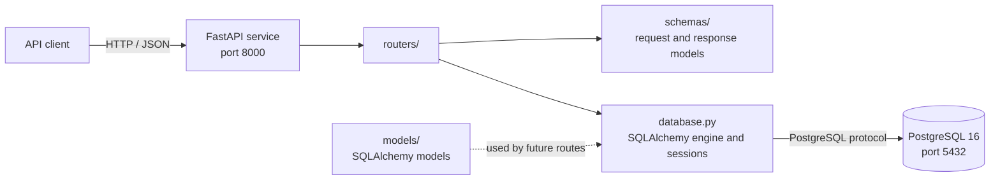
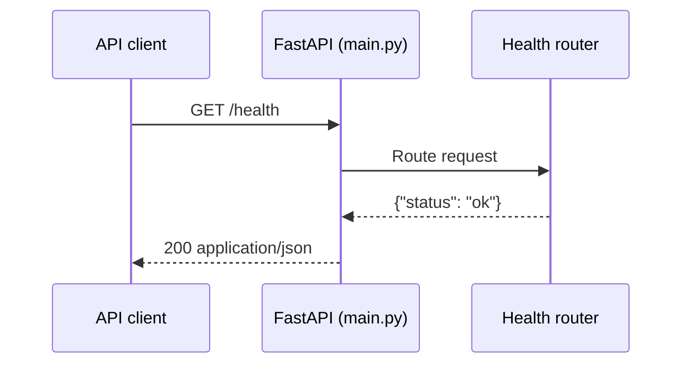

# HomeMatch

HomeMatch is an early-stage backend for a home matching service. The current foundation is a JSON REST API built with FastAPI, SQLAlchemy, and PostgreSQL, with both services configured to run through Docker Compose.

> The project currently includes a health endpoint and database connection/session setup. Property, user, and matching features have not been implemented yet.

## Architecture schematic



## Request schematic



## Requirements

- Docker Engine and the Docker Compose plugin
- Git (optional, for cloning the project)

No local Python installation is needed when running the API in Docker.

## Run locally with Docker

1. Create your local environment file from the example:

   ```sh
   cp .env.example .env
   ```

2. Start the API and PostgreSQL:

   ```sh
   docker compose up --build
   ```

Compose waits for PostgreSQL's health check before starting the API. The API is available at `http://localhost:8000`.

To stop the services, press `Ctrl+C`, then run `docker compose down`. PostgreSQL data is stored in the named `postgres_data` volume and remains when containers are stopped or removed. To remove that data too, run `docker compose down --volumes`.

## Configuration

Compose reads settings from `.env`. The tracked `.env.example` documents the expected values:

| Variable | Purpose | Example |
| --- | --- | --- |
| `POSTGRES_DB` | Database created by the PostgreSQL container | `homematch` |
| `POSTGRES_USER` | PostgreSQL application user | `homematch` |
| `POSTGRES_PASSWORD` | Password for that user | Change the example value locally |
| `DATABASE_URL` | SQLAlchemy connection URL used by the API container | `postgresql+psycopg://homematch:...@db:5432/homematch` |

The hostname `db` is the Compose service name and is used by the API container. From a database client on your host, connect to `localhost:5432`. The example credentials are for local development only; use private, strong credentials in any shared or deployed environment.

## API

| Method | Path | Response |
| --- | --- | --- |
| `GET` | `/health` | `200` — `{"status":"ok"}` |

FastAPI also serves the generated OpenAPI contract and interactive API documentation:

- Swagger UI: `http://localhost:8000/docs`
- ReDoc: `http://localhost:8000/redoc`
- OpenAPI JSON: `http://localhost:8000/openapi.json`

All API responses use JSON. The health check currently confirms the API process is responding; it does not check database connectivity.

## Project structure

```text
.
├── database.py          # SQLAlchemy engine, base class, and session dependency
├── Dockerfile           # Container image for the FastAPI service
├── docker-compose.yml   # API and PostgreSQL services
├── main.py              # FastAPI application and router registration
├── models/              # SQLAlchemy model package (ready for domain models)
├── requirements.txt     # Python dependencies
├── routers/             # HTTP endpoints; currently includes /health
└── schemas/             # Pydantic request/response schemas
```

## Backend conventions

- Add HTTP endpoints under `routers/` and include their routers in `main.py`.
- Define API input and output contracts in `schemas/` so they appear in OpenAPI.
- Define relational entities in `models/` using the shared `Base` from `database.py`.
- Use the `get_db` dependency from `database.py` to obtain and close request-scoped database sessions.
- Return structured JSON from API endpoints.

Database tables and migrations are not configured yet. Add a migration workflow before relying on persistent application schemas.
