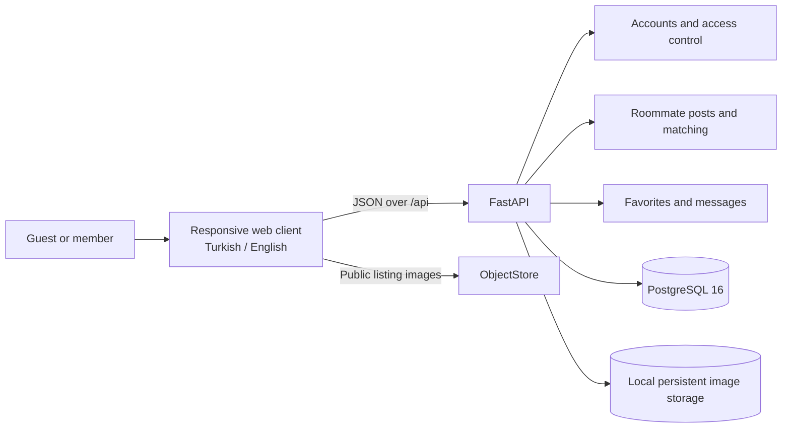
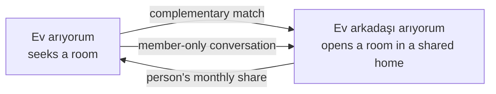

# HomeMatch

HomeMatch helps people find a compatible flatmate. There is no landlord role: any member can post that they are looking for a room, looking for a flatmate, or both.

## Architecture





The web client is plain HTML, CSS, and JavaScript. Nginx serves it and proxies `/api/*` to FastAPI. FastAPI publishes the JSON/OpenAPI contract at `/openapi.json` and `/docs`.

## Run with Docker Compose

Requirements: Docker Engine and the Docker Compose plugin.

```sh
cp .env.example .env
docker compose up --build
```

- Web app: <http://localhost:8080>
- API: <http://localhost:8000>
- API docs: <http://localhost:8000/docs>
- OpenAPI JSON: <http://localhost:8000/openapi.json>
- PostgreSQL: `localhost:5432`

The API waits for PostgreSQL, then applies Alembic migrations before starting. PostgreSQL data and uploaded images persist in named Docker volumes. Stop containers with `docker compose down`; remove local database and images with `docker compose down --volumes`.

Use only development credentials locally. Set unique `POSTGRES_PASSWORD` and `JWT_SECRET` before deployment. `.env` is ignored by Git; keep real secrets out of `.env.example` and source control.

## Product flow

- **Ev arıyorum:** A member shares an introduction, preferred location, maximum monthly share, move-in date, and personal lifestyle details.
- **Ev arkadaşı arıyorum:** A member with a room available shares home details, the monthly amount requested from the incoming person, availability, and household rules.
- Members can create either or both post types. A monthly amount is displayed as entered; the app does not split rent or transfer money.
- Public visitors can browse listing cards and details. Profile introductions and lifestyle details, favorites, matching, and messaging require login.
- Matching compares only complementary post types. Its score weights location (30%), rent (30%), lifestyle (25%), and move-in date (15%). A breakdown is included with each result.
- Photos are limited to five JPEG, PNG, or WebP images per post, up to 10 MB per image. Local Compose stores image files in a persistent Docker volume; image keys are stored in PostgreSQL and files are served at `/uploads/`.

## API overview

All request and response payloads are JSON except photo uploads (`multipart/form-data`). Authentication uses a bearer token returned by register/login.

| Method | Path | Access | Purpose |
| --- | --- | --- | --- |
| `GET` | `/health` | Public | Process health |
| `GET` | `/health/ready` | Public | API and PostgreSQL readiness |
| `POST` | `/translate` | Public | Translate up to 450 characters between Turkish and English via MyMemory |
| `POST` | `/auth/register` | Public | Create an account and return token |
| `POST` | `/auth/login` | Public | Sign in and return token |
| `GET`, `PATCH` | `/auth/me` | Member | Read/update introduction |
| `GET` | `/posts` | Public | Browse/filter active posts |
| `POST` | `/posts` | Member | Create either post type |
| `GET` | `/posts/{id}` | Public | Read listing details without personal profile |
| `GET` | `/posts/{id}/profile` | Member | Read post and author's introduction/lifestyle details |
| `PATCH`, `DELETE` | `/posts/{id}` | Post author | Update or delete a post |
| `POST`, `DELETE` | `/posts/{id}/images` | Post author | Add/remove listing photos |
| `GET` | `/posts/{id}/matches` | Post author | Find and score complementary posts |
| `GET` | `/me/posts`, `/me/favorites` | Member | Read own posts and favorites |
| `PUT`, `DELETE` | `/me/favorites/{post_id}` | Member | Add/remove a favorite |
| `POST` | `/posts/{id}/conversations` | Member | Start/reuse a conversation with the post author |
| `GET` | `/me/conversations` | Member | List conversations |
| `GET`, `POST` | `/conversations/{id}/messages` | Participants | Read/send messages |

Post type values are `looking_for_room` and `looking_for_roommate`. Registration requires email, password (10+ characters), display name, and a 20–1200 character introduction. Post creation validates the fields required for its selected type. The generated OpenAPI document is the detailed contract for field types and error responses.

## Project layout

```text
.
├── frontend/             # Static responsive client and Nginx API proxy
├── models/               # SQLAlchemy entities
├── migrations/           # Alembic schema migrations
├── routers/              # Auth, posts, profile, health, and messaging routes
├── schemas/              # Pydantic JSON request/response contracts
├── services/             # Matching and local upload storage helpers
├── database.py           # SQLAlchemy engine and session dependency
├── docker-compose.yml    # Web, API, and PostgreSQL services
└── main.py               # FastAPI app and route registration
```

The first migration runs automatically in Compose. When changing database models, create and review a new Alembic migration before shipping the change. This is an MVP foundation; it does not include moderation, payment collection, rent transfers, or real-time messaging.
