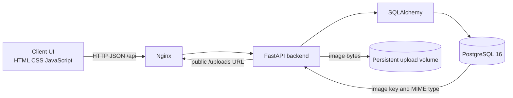
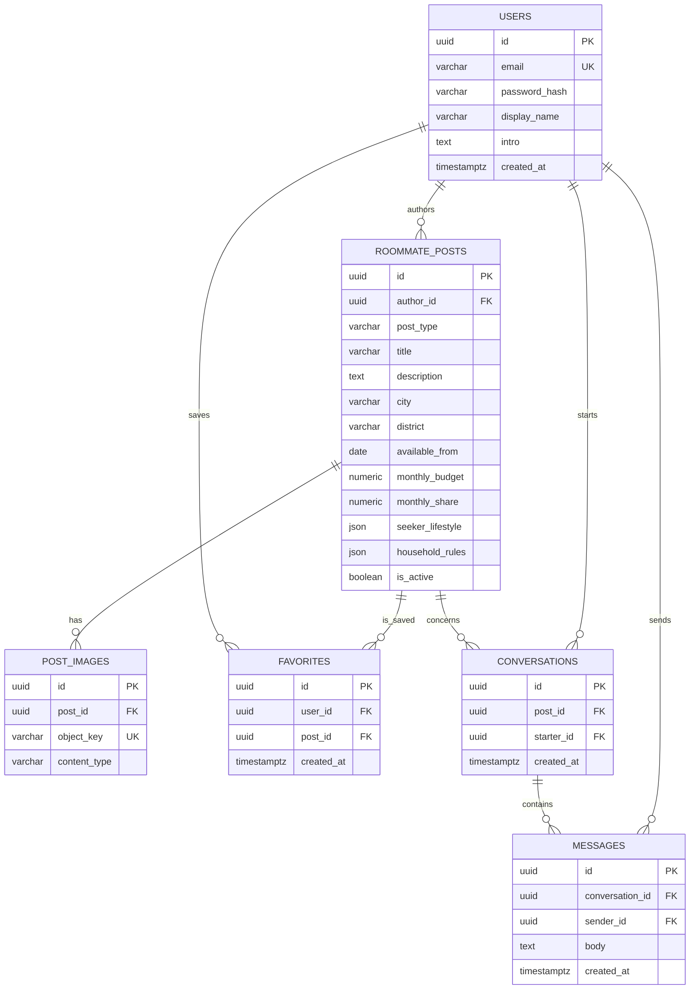

# HomeMatch: A Relational Platform for Flatmate Discovery

## Project Inception and Three-Part Specialized Role Report

> **Submission cover — complete before PDF export**  
> **Project name:** HomeMatch: A Relational Platform for Flatmate Discovery  
> **Squad:** [Squad number/name]  
> **Course / section:** [Course and section]  
> **Submission date:** [Date]

| Squad member — full name | Student ID | University email | Assigned role |
| --- | --- | --- | --- |
| [Member 1 full name] | [Student ID] | [University email] | Business Owner / Domain Analyst (BO) |
| [Member 2 full name] | [Student ID] | [University email] | Developer / Database Designer (DD) |
| [Member 3 full name] | [Student ID] | [University email] | AI Systems Developer (AID) |
| [Member 4 full name] | [Student ID] | [University email] | [Agreed squad role] |

**Formatting for final submission:** Set body text to 11–12 pt Times New Roman or Calibri, use 1.15 line spacing, retain bold section headings, fill in all cover fields, and export this complete report as one PDF. Mermaid diagrams should be rendered by the Markdown-to-PDF tool.

---

# PART 1 — BUSINESS OWNER (BO) REPORT

## 1. Project title

**HomeMatch: A Relational Platform for Flatmate Discovery**

This is the professional project title used throughout this report. The product name is drawn from the existing repository, while the descriptive subtitle clarifies its domain and purpose.

## 2. Short description

HomeMatch connects people seeking a room with people offering a room in a shared home. It combines structured listings, lifestyle compatibility, favorites, and private conversations so users can assess potential flatmates before arranging a real-world meeting.

## 3. Target users and stakeholders

| Persona / stakeholder | Goals and responsibilities | System interaction |
| --- | --- | --- |
| **Room seeker** | Find a room within a budget and preferred location; communicate lifestyle needs and intended move-in date. | Publishes a `looking_for_room` listing, filters offers, views compatible listings, favorites options, and contacts an advertiser. |
| **Room provider / existing flatmate** | Find a compatible person for an available room; describe the monthly share, household expectations, and availability. | Publishes a `looking_for_roommate` listing, reviews seekers, manages listing photos, and responds to conversations. |
| **Registered member with both needs** | Seek a room while also offering a room, possibly across different situations or dates. | May create either or both complementary listing types under one account. |
| **Visitor / prospective member** | Explore available listings before deciding whether to register. | Browses public listing cards and public listing details; must sign in to access profiles, favorites, matching, and messaging. |
| **Platform operator / maintainer** | Keep the API, database, file storage, and deployment configuration operational; protect credentials and maintain schema changes. | Runs the Docker Compose services, monitors health endpoints, configures secrets, and applies Alembic migrations. |

There is no landlord role in the product model: either member can be seeking a room, offering a room, or both. The personas reflect the domain and access model documented in the project [README](README.md) and implemented in the [API routers](routers/).

## 4. Domain narrative and problem statement

Finding a compatible flatmate is a two-sided coordination problem. One person may have a room available in a shared home, while another person is searching for a room. A useful match depends on more than whether a room exists. The parties must compare location, affordability, move-in timing, and expectations about daily life in a shared space. Those expectations can include smoking, pets, sleep schedules, cleanliness, and how often guests visit. The two parties also need a reasonably private way to ask questions and decide whether to meet.

In an informal process, a seeker may rely on social-media posts, group chats, classified advertisements, spreadsheets, or messages passed through friends. Information is often unstructured: one post gives a neighborhood but no district, another describes rent without specifying whether it is the full rent or one person's share, and a third omits the move-in date. People repeat the same questions across separate conversations. Searchers manually compare listings, save links in notes, and may discover that a room has already been taken. Providers may receive many low-relevance inquiries while compatible seekers miss a listing because it is buried in a feed.

These operational weaknesses create concrete failure modes. First, incomplete or inconsistent listing data makes comparison unreliable. A price such as “12,000” is ambiguous if the listing does not establish whether it is a monthly share, a budget ceiling, or a total household amount. Second, people can overlook constraints that matter after move-in: incompatible expectations about pets, smoking, sleep, or visitors can produce conflict even when location and price appear suitable. Third, updates are not synchronized when copied between channels. A person may remove a post in one group but leave an old version elsewhere. Fourth, personal introductions and contact details may be exposed to an unnecessarily broad audience when public posts and private conversations are mixed together. Finally, repeated inquiries and changing availability make it difficult to reconstruct which listing a conversation concerns.

HomeMatch addresses these problems with a centralized application and a structured relational database. Each member has one durable account identity. Each listing is attached to its author and stores the fields used to describe one of two explicit listing types. Listing photos are linked to the listing, favorites connect members to saved listings, and conversations are associated with the listing that prompted contact. Messages belong to a conversation and record their sender and creation time. These relationships make it possible to ask consistent questions of the data: find active complementary listings in a city, identify which member authored a post, retrieve only a user's saved listings, and show a conversation to its participants.

A relational database is important because the core domain consists of related records with integrity requirements. A favorite must refer to an existing user and listing. A message must refer to a conversation and a sender. A conversation must refer to a listing and its starter. Deleting a listing should not leave orphaned image metadata or conversations. Uniqueness rules should prevent a member from saving the same listing repeatedly or creating multiple logical conversations for the same listing and starter. Transactions are needed when several records must change together, such as saving an uploaded image and its database metadata. Indexes support common lookups by listing type, author, city, district, active status, and conversation. A collection of unrelated documents or manually maintained spreadsheets would make these links, uniqueness rules, ownership checks, and concurrent updates harder to enforce consistently.

HomeMatch therefore treats the database as the authoritative store for accounts, listings, image metadata, favorites, conversations, and messages. The user interface is a client of an API, not the source of truth. The backend validates requests and checks ownership before changes are committed. Public listing details are kept separate from the authenticated profile endpoint, so the product can expose discovery information without automatically exposing a member's introduction. The matching service calculates a compatibility score from listing data and returns a breakdown; the score itself is derived at request time rather than saved as a fixed database fact.

The system is intentionally an MVP for discovery and initial communication. It does not verify leases, guarantee that a listing is genuine, collect rent, arrange legal agreements, or provide real-time messaging. A successful match is a starting point for people to verify the room and make their own decision. This boundary keeps the current database focused on the actual workflow instead of claiming responsibilities the software does not perform. Product scope and operational limits are described in the project [README](README.md); current implementation details are in [models/entities.py](models/entities.py), [services/matching.py](services/matching.py), and the [routers](routers/).

## 5. Deterministic business rules

The rules below express the current product behavior in testable language. Rules labeled **Implemented** are visible in the repository. Rules labeled **Proposed control** are explicit recommendations for production hardening where the current schema or code does not fully enforce the condition.

| Rule | Deterministic rule | Status / basis |
| --- | --- | --- |
| **BR-01 — Listing type** | Every listing shall have exactly one type: `looking_for_room` or `looking_for_roommate`. | Implemented by the `PostType` enum in [models/entities.py](models/entities.py). |
| **BR-02 — Listing ownership** | Every listing shall reference exactly one registered author. Only that author may update, delete, or manage the listing's images. | Implemented in [routers/posts.py](routers/posts.py); author FK in [models/entities.py](models/entities.py). |
| **BR-03 — Seeker requirements** | A `looking_for_room` listing shall provide a monthly budget and seeker lifestyle data; it shall not accept offer-only fields such as monthly share or household rules. | Validated in [schemas/posts.py](schemas/posts.py) and [routers/posts.py](routers/posts.py). |
| **BR-04 — Room offer requirements** | A `looking_for_roommate` listing shall provide a monthly share and household rules; it shall not accept seeker-only fields such as monthly budget or seeker lifestyle data. | Validated in [schemas/posts.py](schemas/posts.py) and [routers/posts.py](routers/posts.py). |
| **BR-05 — Public visibility** | Public listing queries and public detail shall return active listings only. Personal profile details shall be returned only through an authenticated profile endpoint. | Implemented in [routers/posts.py](routers/posts.py). |
| **BR-06 — Complementary matching** | A seeker may match only with an active room-offer listing, and a room offer may match only with an active seeker listing. A member's own listing shall not be returned as a match. | Implemented in [services/matching.py](services/matching.py) and [routers/posts.py](routers/posts.py). |
| **BR-07 — Budget eligibility** | A candidate room offer shall be excluded when its monthly share is greater than the seeker listing's monthly budget. | Implemented in [routers/posts.py](routers/posts.py). |
| **BR-08 — Match score** | Eligible matches shall be scored from location (30%), rent (30%), lifestyle (25%), and move-in date (15%); the response shall include the overall score and the component breakdown. | Implemented in [services/matching.py](services/matching.py) and [schemas/posts.py](schemas/posts.py). The score is calculated, not stored. |
| **BR-09 — Favorite uniqueness** | A member may have at most one favorite record for a given listing. Removing a favorite that does not exist shall not create a new record. | Unique constraint in [models/entities.py](models/entities.py); idempotent application behavior in [routers/me.py](routers/me.py). |
| **BR-10 — Conversation uniqueness and access** | For a given listing and conversation starter, at most one conversation may exist. Only the listing author and the starter may read or send messages in that conversation. | Unique constraint in [models/entities.py](models/entities.py); participant check in [routers/messaging.py](routers/messaging.py). |
| **BR-11 — Image quota** | A listing shall have no more than five images. Each image shall be JPEG, PNG, or WebP and shall not exceed 10 MiB. | Application-level validation in [routers/posts.py](routers/posts.py); concurrent enforcement needs the locking control in Part 3. |
| **BR-12 — Account credentials** | A registered email shall be unique; passwords shall be stored as a one-way hash, and authenticated requests shall use an unexpired bearer token. | Unique email and security implementation in [models/entities.py](models/entities.py) and [security.py](security.py). |
| **BR-13 — Deletion integrity** | Deleting a listing shall remove its image metadata, favorites, conversations, and dependent messages; deleting a conversation shall remove its messages. | Foreign-key/ORM cascade behavior in [models/entities.py](models/entities.py) and [migrations/versions/0001_initial.py](migrations/versions/0001_initial.py). Files are also explicitly removed by application code. |
| **BR-14 — Listing result limit** | A public listing search shall return no more than 100 records in one request. | Implemented in [routers/posts.py](routers/posts.py); pagination is not currently exposed. |

The repository enforces several rules in application code rather than database `CHECK` constraints. Part 2 identifies that difference and recommends database-level constraints where appropriate.

---

# PART 2 — DEVELOPER AND DATABASE DESIGNER (DD) REPORT

## 1. System architecture

HomeMatch follows a three-tier architecture:

1. **Client UI:** A responsive static HTML/CSS/JavaScript web client, served by Nginx. It displays listings, forms, profiles, favorites, and conversations.
2. **Backend API:** FastAPI routes validate JSON requests with Pydantic schemas, apply business rules and authorization, and use SQLAlchemy to access persistent data. Nginx proxies `/api/*` requests to this tier.
3. **Relational database engine:** PostgreSQL 16 stores users, listings, image metadata, favorites, conversations, and messages. Alembic manages schema migrations.

Listing image bytes are kept in a persistent local Docker volume, while their object keys and content types are stored relationally in PostgreSQL. The static web tier and API are separate containers. The architecture is documented in [README.md](README.md) and configured in [docker-compose.yml](docker-compose.yml), [frontend/nginx.conf](frontend/nginx.conf), and [main.py](main.py).



## 2. Core relational schema

The deployed project uses six core entities. Primary keys are UUID surrogate keys, not natural keys. The SQL types below describe PostgreSQL equivalents suitable for the implemented SQLAlchemy model. `UUID` values are generated by the application. `NUMERIC(10,2)` is preferable to floating-point for persisted money values; the implementation maps these amounts to SQLAlchemy `Numeric(10,2)`.

### 2.1 `users`

- **Primary key:** `id UUID PRIMARY KEY` — surrogate key.
- **Foreign keys:** None.
- **Attributes:**

| Column | SQL type | Nullability / constraint |
| --- | --- | --- |
| `id` | `UUID` | `NOT NULL`, primary key |
| `email` | `VARCHAR(320)` | `NOT NULL`, `UNIQUE`, indexed |
| `password_hash` | `VARCHAR(255)` | `NOT NULL` |
| `display_name` | `VARCHAR(80)` | `NOT NULL` |
| `intro` | `TEXT` | `NOT NULL`; application currently requires 20–1200 characters on registration/profile update |
| `created_at` | `TIMESTAMPTZ` | `NOT NULL`, default current timestamp |

**Purpose and rules:** Persists account identity, authentication hash, and member introduction. Supports BR-02, BR-05, BR-10, and BR-12. The email is a natural candidate key but the schema uses a generated UUID as the PK and enforces email uniqueness separately.

### 2.2 `roommate_posts`

- **Primary key:** `id UUID PRIMARY KEY` — surrogate key.
- **Foreign keys:** `author_id UUID REFERENCES users(id) ON DELETE CASCADE`.
- **Attributes:**

| Column | SQL type | Nullability / constraint |
| --- | --- | --- |
| `id` | `UUID` | `NOT NULL`, primary key |
| `author_id` | `UUID` | `NOT NULL`, FK to `users.id`, indexed |
| `post_type` | `VARCHAR(32)` / constrained enum | `NOT NULL`, indexed; values `looking_for_room`, `looking_for_roommate` |
| `title` | `VARCHAR(120)` | `NOT NULL` |
| `description` | `TEXT` | `NOT NULL` |
| `city` | `VARCHAR(80)` | `NOT NULL`, indexed |
| `district` | `VARCHAR(80)` | `NOT NULL`, indexed |
| `available_from` | `DATE` | `NOT NULL` |
| `monthly_budget` | `NUMERIC(10,2)` | Nullable; seeker listing field |
| `monthly_share` | `NUMERIC(10,2)` | Nullable; offer listing field |
| `room_type` | `VARCHAR(20)` | Nullable |
| `total_roommates` | `INTEGER` | Nullable |
| `utilities_note` | `VARCHAR(300)` | `NOT NULL`, default empty string |
| `seeker_lifestyle` | `JSON` | Nullable; seeker preferences |
| `household_rules` | `JSON` | Nullable; household conditions |
| `is_active` | `BOOLEAN` | `NOT NULL`, default `TRUE`, indexed |
| `created_at` | `TIMESTAMPTZ` | `NOT NULL`, default current timestamp |
| `updated_at` | `TIMESTAMPTZ` | `NOT NULL`, default/current update timestamp |

**Purpose and rules:** Stores both sides of the marketplace in a shared table; type-specific nullable columns are interpreted according to `post_type`. Supports BR-01 through BR-08, BR-11, and BR-14. The compatibility score is computed by the matching service and is deliberately not a persisted column.

### 2.3 `post_images`

- **Primary key:** `id UUID PRIMARY KEY` — surrogate key.
- **Foreign keys:** `post_id UUID REFERENCES roommate_posts(id) ON DELETE CASCADE`.
- **Attributes:** `object_key VARCHAR(500) NOT NULL UNIQUE`, `content_type VARCHAR(80) NOT NULL`, and `created_at TIMESTAMPTZ NOT NULL DEFAULT CURRENT_TIMESTAMP`, in addition to `id` and `post_id`.
- **Purpose and rules:** Stores metadata and the path key for an image; the binary image resides in the persistent upload volume. Supports BR-02, BR-11, and BR-13. `object_key` is unique so that two records cannot claim the same stored file path.

### 2.4 `favorites`

- **Primary key:** `id UUID PRIMARY KEY` — surrogate key.
- **Foreign keys:** `user_id UUID REFERENCES users(id) ON DELETE CASCADE`; `post_id UUID REFERENCES roommate_posts(id) ON DELETE CASCADE`.
- **Attributes:** `created_at TIMESTAMPTZ NOT NULL DEFAULT CURRENT_TIMESTAMP`, in addition to `id`, `user_id`, and `post_id`.
- **Unique constraint:** `UNIQUE(user_id, post_id)`.
- **Purpose and rules:** Implements the many-to-many saved-listing relationship between users and posts. Supports BR-09 and BR-13.

### 2.5 `conversations`

- **Primary key:** `id UUID PRIMARY KEY` — surrogate key.
- **Foreign keys:** `post_id UUID REFERENCES roommate_posts(id) ON DELETE CASCADE`; `starter_id UUID REFERENCES users(id) ON DELETE CASCADE`.
- **Attributes:** `created_at TIMESTAMPTZ NOT NULL DEFAULT CURRENT_TIMESTAMP`, in addition to `id`, `post_id`, and `starter_id`.
- **Unique constraint:** `UNIQUE(post_id, starter_id)`.
- **Purpose and rules:** Persists a conversation started in the context of a listing. The other participant is derived from the listing author; it is not duplicated as a stored participant field. Supports BR-10 and BR-13.

### 2.6 `messages`

- **Primary key:** `id UUID PRIMARY KEY` — surrogate key.
- **Foreign keys:** `conversation_id UUID REFERENCES conversations(id) ON DELETE CASCADE`; `sender_id UUID REFERENCES users(id) ON DELETE CASCADE`.
- **Attributes:** `body TEXT NOT NULL`, `created_at TIMESTAMPTZ NOT NULL DEFAULT CURRENT_TIMESTAMP`, in addition to `id`, `conversation_id`, and `sender_id`.
- **Purpose and rules:** Stores message content and authorship in a conversation. Supports BR-10 and BR-13. Message delivery is request/response based; the schema does not represent read receipts or real-time delivery state.

The authoritative implementation is [models/entities.py](models/entities.py), with the initial database DDL represented in [migrations/versions/0001_initial.py](migrations/versions/0001_initial.py).

## 3. Relationships and cardinalities

| Relationship | Cardinality | Relational implementation |
| --- | --- | --- |
| User → listing | One-to-many (1:N) | `roommate_posts.author_id` references `users.id`. One member may publish multiple listings; each listing has one author. |
| Listing → image | One-to-many (1:N) | `post_images.post_id` references `roommate_posts.id`. One listing has zero to five images. |
| User ↔ listing favorites | Many-to-many (M:N) | Resolved by junction table `favorites`; each user can save many listings and each listing can be saved by many users. Pair uniqueness prevents duplicate edges. |
| Listing → conversation | One-to-many (1:N) | `conversations.post_id` references `roommate_posts.id`. A listing may have conversations with multiple prospective members. |
| User → started conversation | One-to-many (1:N) | `conversations.starter_id` references `users.id`. A member may start conversations about multiple listings. |
| Conversation → message | One-to-many (1:N) | `messages.conversation_id` references `conversations.id`. A conversation has zero or more messages. |
| User → sent message | One-to-many (1:N) | `messages.sender_id` references `users.id`. A member may send many messages. |

The listing author and conversation starter form the two participant roles. The application checks these roles before returning or accepting messages ([routers/messaging.py](routers/messaging.py)).



## 4. Integrity constraints and normalization

### 4.1 Constraints implemented in the repository

- Primary keys are UUID surrogate keys on all six tables.
- `users.email` and `post_images.object_key` are unique.
- `favorites(user_id, post_id)` and `conversations(post_id, starter_id)` have composite unique constraints.
- Foreign keys connect child records to their parents. The initial migration uses `ON DELETE CASCADE` on user, listing, and conversation dependencies; the ORM also configures delete-orphan behavior for images and messages.
- Important lookup fields have indexes, including email, author, post type, city, district, active status, post/image foreign keys, conversation foreign keys, and sender foreign keys.
- Application validation enforces listing-type requirements, image file type/size/count, text lengths, and ownership checks.

### 4.2 Recommended database-level constraints

The current model does not declare all domain rules as SQL `CHECK` constraints. For stronger integrity against alternate clients, imports, or future services, add and migrate constraints such as:

```sql
CHECK (post_type IN ('looking_for_room', 'looking_for_roommate'));
CHECK (monthly_budget IS NULL OR monthly_budget > 0);
CHECK (monthly_share IS NULL OR monthly_share > 0);
CHECK (total_roommates IS NULL OR total_roommates > 0);
CHECK (
  (post_type = 'looking_for_room'
   AND monthly_budget IS NOT NULL
   AND seeker_lifestyle IS NOT NULL)
  OR
  (post_type = 'looking_for_roommate'
   AND monthly_share IS NOT NULL
   AND household_rules IS NOT NULL)
);
```

Also retain `NOT NULL` on identifiers, ownership keys, required listing fields, message bodies, and timestamps. A database cannot directly check that a message sender is one of the two participants using an ordinary row-local `CHECK`; enforce that with transactional application logic or a carefully designed trigger. Likewise, the five-image quota spans multiple rows and requires a transaction/locking strategy or a trigger with equivalent serialization.

For deletion, `CASCADE` is appropriate for dependent records such as image metadata, favorites, conversations, and messages when a user or listing is deleted. If the product later needs legally auditable retention or soft deletion, replace destructive user deletion with an explicit deactivation/anonymization policy and review the dependent FK behavior. These are design recommendations; current cascade behavior is described in [models/entities.py](models/entities.py) and the first migration.

### 4.3 Derived data policy

Following the assignment's normalization guidance, the overall match score and its location/rent/lifestyle/move-date components are not stored as static columns. They are derived from current listing attributes when `/posts/{id}/matches` is requested ([services/matching.py](services/matching.py)). This avoids stale scores after a user changes a listing. If performance later requires caching, the cache must be explicitly invalidated when any input changes and treated as derived data, not an independent source of truth.

## 5. API surface and database mapping

The API is JSON-based except for multipart image uploads. The generated OpenAPI contract is available from FastAPI at `/openapi.json` and `/docs`. Main endpoint groups are:

| API group | Representative routes | Primary entities |
| --- | --- | --- |
| Health and translation | `GET /health`, `GET /health/ready`, `POST /translate` | Database connectivity; external translation service |
| Authentication and profile | `POST /auth/register`, `POST /auth/login`, `GET/PATCH /auth/me` | `users` |
| Listings and matching | `GET/POST /posts`, `GET/PATCH/DELETE /posts/{id}`, `GET /posts/{id}/matches` | `roommate_posts`, `users` |
| Listing photos | `POST/DELETE /posts/{id}/images` | `post_images`, file volume |
| Member collection | `GET /me/posts`, `GET /me/favorites`, `PUT/DELETE /me/favorites/{post_id}` | `roommate_posts`, `favorites` |
| Messaging | `POST /posts/{id}/conversations`, `GET /me/conversations`, `GET/POST /conversations/{id}/messages` | `conversations`, `messages`, `users` |

The endpoint inventory is documented in [README.md](README.md#api-overview); concrete route handlers and request/response schemas reside under [routers/](routers/) and [schemas/](schemas/).

---

# PART 3 — AI DEVELOPER (AID) REPORT

## 1. Verbatim AI prompt audit

### Audit status

The repository contains no prompt log, and the project-inception conversation did not record a structured set of prompts submitted to ChatGPT, Claude, or Gemini. Therefore, no historical prompt can honestly be presented as verbatim. The following is a **reconstructed prompt for the current report**, based on the project and assignment. It is not evidence that the squad previously submitted these exact words to an LLM. Before final submission, the squad should replace or supplement this section with actual prompt text and identify the model/tool and date used. Do not label a reconstructed prompt as historical verbatim evidence.

### Reconstructed prompt (English; not historical verbatim)

```text
You are assisting a university project squad with database systems project inception.
Analyze the existing HomeMatch repository, a flatmate-discovery web application.
Use only facts supported by repository files, and cite the relevant file paths.
Prepare an English report with three parts:

1. Business Owner / Domain Analyst: state the project title and value proposition;
define target personas; explain the real-world problem and why relational storage is
needed; write at least ten deterministic business rules.

2. Developer / Database Designer: describe the client/API/relational-database
architecture; document every core entity with UUID or natural primary key, foreign
keys, realistic SQL types, purpose, relationships, cardinalities, uniqueness,
NOT NULL, CHECK, and deletion rules. Distinguish constraints implemented in the
repository from recommendations. Do not persist calculated match scores as static
columns.

3. AI Systems Developer: audit prompts honestly without fabricating historical
prompt text; compare HomeMatch with two current commercial roommate-finding
platforms using authoritative sources; separate adopted ideas from rejected or
deferred features; analyze a project-specific concurrency risk and explain a
transactional row-locking remedy.

Keep the report academically clear and entirely in English. Mark unknown squad
names, student IDs, university emails, and roles as fields to be completed rather
than inventing them. Include architecture and ER diagrams suitable for rendering
in a single PDF.
```

## 2. Commercial software benchmark

The comparison uses official product pages and help materials accessed on **26 October 2026**. Features and commercial terms can change; the cited official sources should be checked again when the squad submits its final PDF.

| Capability | HomeMatch (this project) | SpareRoom | Roomies.com |
| --- | --- | --- | --- |
| Domain workflow | Seeker and room-offer listings; filters, weighted compatibility, favorites, and member conversations. | Supports both finding a room and filling a room; users create ads, search/filter by location and budget, contact advertisers, and arrange viewings. [Official “How it works” page](https://www.spareroom.com/content/about-us/how-spareroom-works/) |
| Profile / household fit | Structured seeker lifestyle and household rules feed a transparent four-part score. | Ads include personal and room information; search offers advanced criteria. The public product description emphasizes browsing and direct contact rather than publishing a weighted score formula. [Official FAQ](https://www.spareroom.com/content/info-faq/faq) |
| Communication | In-app conversation and messages scoped to the listing author and starter. No real-time transport. | In-house messaging; the FAQ says messages go to the platform inbox and email alerts can notify the recipient. It describes automated scam-language checks. [Official FAQ](https://www.spareroom.com/content/info-faq/faq) |
| Monetization / access | No payment collection or rent transfer; current MVP has no paid visibility tier. | Free ads and browsing are available; some early contact and promoted listing options use upgrades. [Official site explanation](https://www.spareroom.com/content/info-faq/how-the-site-works/) |
| Shared-home management | Out of scope; no chore, shared-bill, or complaint tracking. | Focuses on finding rooms/flatmates and connecting potential housemates. | The Roomies product describes apartment creation, open-room discovery, join requests, chores, shared expenses, one-to-one chat, complaints, and ratings. [Official product page](https://joinroomies.com/) |
| Fit for HomeMatch's stated MVP | Baseline architecture supports discovery and first contact while keeping money and post-move-in operations out of scope. | Strong reference for two-sided ads, filters, photos, and user-to-user contact. | Useful reference for a possible later shared-household operations module, but it would expand the current domain significantly. |

**Benchmark conclusion:** HomeMatch's current scope is closest to the discovery and contact workflow described by SpareRoom. Roomies demonstrates a broader post-move-in management domain. The project should treat household chores, expenses, complaints, identity verification, paid boosts, and automated moderation as separate product decisions rather than silently adding them to the current schema. This is a feature-scope comparison based on public vendor descriptions, not a claim that the products use the same internal architecture or database design.

## 3. Feasibility sieve: adopted, rejected, and deferred ideas

The repository does not contain a saved list of ideas generated by an AI assistant. The following is therefore a transparent **design feasibility review** of capabilities relevant to HomeMatch, not a claim that a historical AI proposal was accepted or rejected.

### Adopted in the current relational design

| Capability | Relational representation | Reason for adoption |
| --- | --- | --- |
| Two complementary listing types | `roommate_posts.post_type` with type-specific fields | This is the central domain distinction and determines required fields and eligible matches. |
| Member accounts and profile introductions | `users` | A stable member identity is needed for ownership, private profile access, and conversation participation. |
| Structured location, budget/share, and availability | Columns on `roommate_posts` | These values support filtering and deterministic eligibility/matching. Money uses `NUMERIC(10,2)`. |
| Lifestyle compatibility inputs | `seeker_lifestyle` and `household_rules` JSON fields | Keeps the current small set of evolving preferences without adding many sparse columns. They are validated by the API schema; frequently queried attributes could later be normalized. |
| Favorites | `favorites` junction table | Supports saved listings with foreign keys and pair uniqueness. |
| Private listing conversations and messages | `conversations` and `messages` | Supports contact tied to a listing and access checks between the two participants. |
| Listing image metadata and persistent files | `post_images` plus a persistent upload volume | Relational metadata and binary file bytes have different storage needs; file count and size are limited. |
| On-demand compatibility score | Matching service calculation | Avoids stale derived values and keeps the database normalized. |

### Rejected or deferred from the current MVP

| Capability | Decision | Justification |
| --- | --- | --- |
| Rent collection, deposits, or money transfer | **Rejected for current scope** | The README explicitly says the application displays user-entered amounts and does not process payments. A payment subsystem would add financial, security, and regulatory obligations unrelated to initial matching. |
| Exact street address on public listings | **Deferred / excluded from public output** | Early discovery needs city and district, while precise address exposure creates avoidable privacy and personal-safety risk. A later viewing workflow could reveal details by consent. |
| Government ID images or background-check documents | **Deferred** | These would add highly sensitive personal data, retention/security requirements, and a verification operation not supported by the current product or schema. No such requirement is documented. |
| Real-time chat, video calling, and push notifications | **Deferred** | Current HTTP messaging is sufficient for MVP contact. Real-time infrastructure would increase operational complexity and does not change the core relational model. |
| Chores, shared expense ledger, bills, and settlement balances | **Deferred** | These are post-move-in household management features, represented by broader products such as Roomies; they introduce separate entities and financial calculation rules. |
| Reputation scores, star ratings, or behavioral ranking | **Deferred** | Requires moderation, dispute handling, anti-retaliation safeguards, and a defined evidence policy. The repository has no moderation or appeal workflow. |
| AI-generated compatibility decisions | **Rejected as an authoritative decision mechanism** | The existing deterministic, explainable score is auditable. A probabilistic model could create opaque or biased recommendations and would require evaluation data and user-facing explanation. |
| Persisted match-score column | **Rejected** | Score is derived from mutable listing inputs. Storing it without invalidation can produce stale results; calculate it at query time or use a carefully invalidated cache. |
| Unlimited photo uploads or arbitrary file formats | **Rejected** | Unbounded storage and file types increase cost and security risk; the current five-image, 10 MiB, JPEG/PNG/WebP limits are concrete and validated. |

## 4. Concurrency risks and edge cases

### Critical race: concurrent image uploads exceed the listing quota

The upload handler currently loads a listing and checks whether it already has five images before writing a new file and inserting a `post_images` row ([routers/posts.py](routers/posts.py)). Consider a listing with four images. Two valid upload requests arrive at nearly the same time:

1. Transaction A reads image count = 4.
2. Transaction B reads image count = 4 before A commits.
3. A inserts its fifth image and commits.
4. B inserts another image and commits.
5. The listing now has six images, even though each request independently passed the check.

This is a **time-of-check/time-of-use race**. A row-level lock on the parent listing serializes the quota check and insert. Both operations must happen in one database transaction; the lock must be held until commit or rollback.

```sql
BEGIN;

-- Serialize quota checks for this listing.
SELECT id
FROM roommate_posts
WHERE id = :post_id
  AND author_id = :current_user_id
FOR UPDATE;

-- Count only after acquiring the listing-row lock.
SELECT COUNT(*)
FROM post_images
WHERE post_id = :post_id;

-- Application verifies count < 5, validates file bytes, then inserts metadata.
INSERT INTO post_images (id, post_id, object_key, content_type, created_at)
VALUES (:image_id, :post_id, :object_key, :content_type, CURRENT_TIMESTAMP);

COMMIT;
```

If the count is already five, the transaction should roll back and return a quota error without leaving an uploaded file. The implementation should coordinate file writing with database failure cleanup, as the existing handler already attempts to do for insert failures. A single transaction and consistent lock order reduce the chance of deadlocks. If the listing row does not exist or does not belong to the caller, reject the request before the file is made durable.

### Additional edge cases to address

- **Duplicate conversation creation:** Two simultaneous requests for the same `(post_id, starter_id)` can both observe no conversation. The unique constraint prevents duplicate rows, but one request may receive a database uniqueness error. Use `INSERT ... ON CONFLICT` (or catch the unique violation and fetch the existing conversation) within a transaction to make “start or reuse” reliably idempotent.
- **Favorite double-submit:** The same race can occur when two requests add the same favorite. The unique constraint protects integrity; handle the conflict as a successful idempotent operation.
- **Listing deletion during image upload:** A listing may be deleted while an upload is being processed. Locking the listing row and using FK cascade protects metadata consistency; on deletion/rollback, remove any file that was already written.
- **Message authorization:** A message sender must be either the listing author or conversation starter. Check participation in the same transaction as message insertion so access is evaluated against a consistent conversation/listing relationship.
- **Budget boundary:** A room share exactly equal to the seeker's budget is eligible; a share greater than the budget is excluded. Decimal comparisons should be used for money instead of binary floating-point arithmetic.
- **Missing lifestyle fields:** If there are no comparable lifestyle fields, the current scoring function returns a lifestyle subscore of zero. This behavior should be confirmed with stakeholders because it can penalize incomplete profiles rather than treating them as unknown.
- **Listing edit while matching:** A listing may change after a candidate query begins. If a consistent snapshot is required for a match response, perform the query and score calculation under a transaction with an appropriate isolation level; otherwise document that the result reflects a best-effort snapshot.

## 5. Sources and repository traceability

### Project sources

- [README.md](README.md) — project scope, architecture, endpoint overview, deployment, and MVP boundaries.
- [AGENTS.md](AGENTS.md) and [rules.md](rules.md) — backend/frontend role separation and API contract expectations.
- [SKILLS.md](SKILLS.md) — technology-stack summary.
- [models/entities.py](models/entities.py) and [migrations/versions/0001_initial.py](migrations/versions/0001_initial.py) — entity definitions, keys, relationships, and initial migration.
- [schemas/](schemas/) and [routers/](routers/) — request/response validation and API behavior.
- [services/matching.py](services/matching.py) — match scoring and complementary listing type.
- [services/storage.py](services/storage.py) — local image storage helpers.
- [docker-compose.yml](docker-compose.yml), [Dockerfile](Dockerfile), [frontend/Dockerfile](frontend/Dockerfile), and [frontend/nginx.conf](frontend/nginx.conf) — deployment topology and proxy configuration.

### Commercial benchmark sources

- SpareRoom, [How SpareRoom works](https://www.spareroom.com/content/about-us/how-spareroom-works/).
- SpareRoom, [Official FAQ](https://www.spareroom.com/content/info-faq/faq).
- SpareRoom, [How the site works](https://www.spareroom.com/content/info-faq/how-the-site-works/).
- Roomies, [Official product page](https://joinroomies.com/).

---

## Final submission checklist

- [ ] Replace every bracketed cover field with the actual squad number, four full names, student IDs, university emails, and assigned roles.
- [ ] Have the squad review the business rules and confirm that proposed controls are clearly distinguished from implemented behavior.
- [ ] Replace or supplement the reconstructed AI prompt with the squad's actual verbatim prompt log, tool/model, and date; do not claim the reconstructed text is historical.
- [ ] Recheck commercial benchmark sources and access dates immediately before submission.
- [ ] Render Mermaid diagrams and confirm tables/code blocks are legible in the PDF.
- [ ] Apply 11–12 pt Times New Roman or Calibri, 1.15 line spacing, and bold section headings.
- [ ] Export all three parts and cover page as exactly one PDF; coordinate one squad member to upload the sole copy to Google Classroom.
